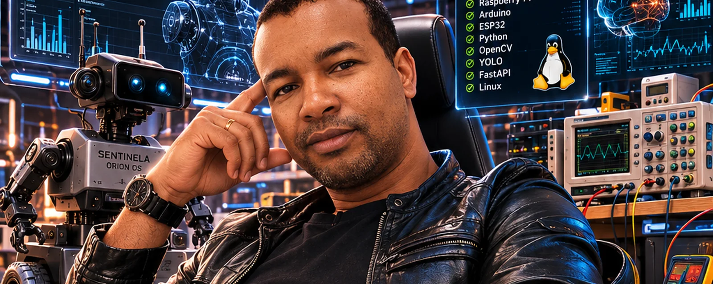
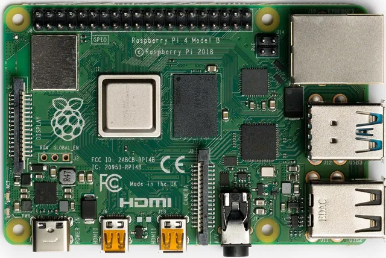
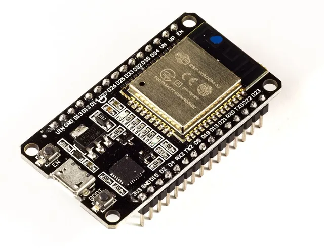
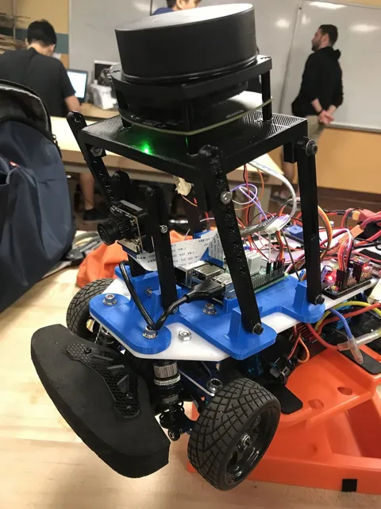
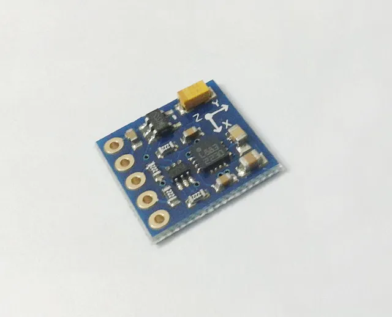
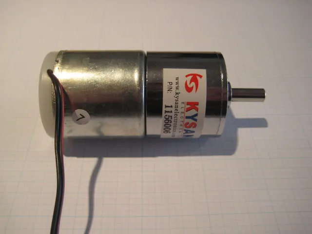
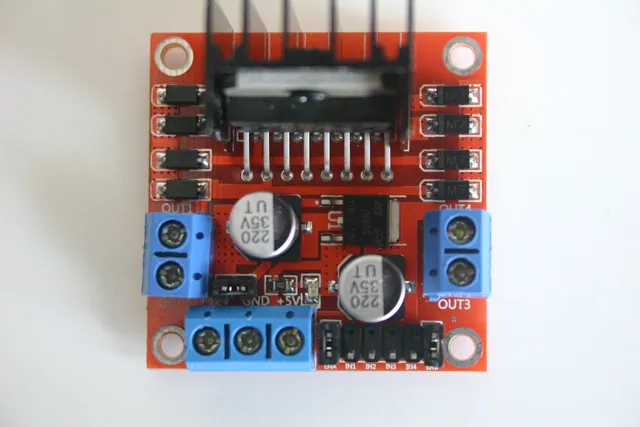
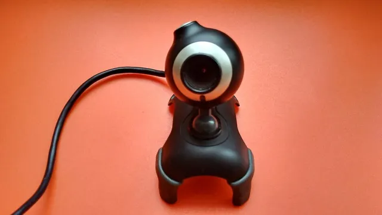

<p align="center">
  
</p>

<h1 align="center">ORION OS</h1>

<p align="center">
  <strong>Plataforma de robótica modular para robôs domésticos autônomos.</strong><br>
  Primeiro robô: <strong>Jarvis</strong> (antes chamado Fofão).
</p>

<p align="center">
  <a href="https://jproma23.github.io/Orion-Os/"></a>
  
  
  
</p>

---

Um robô que percebe o ambiente, decide sozinho o que fazer e conversa com
quem mora na casa. **Tudo que mantém o robô seguro roda local**: visão,
escuta, navegação, memória e segurança. A IA da conversa é remota, por API
(Gemini, EDR-0021). Sem internet, o robô continua seguro, mas conversa
pouco.

**[→ Diário de bordo do desenvolvimento](https://jproma23.github.io/Orion-Os/)**
— cada sessão registrada no dia em que aconteceu, os acertos e os bugs que
custaram caro.

## Arquitetura

Duas máquinas e três ESP32. A divisão vigente é a da
[EDR-0036](docs/edr/EDR-0036-notebook-volta.md) (30/09/2026): o Notebook faz o
trabalho pesado que pode esperar, e o Pi faz o que não pode falhar e guarda o
estado.

```
   ESP32 ouvidos ──Wi-Fi──► Notebook 8 GB         Vision + Voice   câmera DV20, YOLO, rostos, Whisper, IA, Piper
   (2 mics I2S, OTA)             │  TCP (só eventos, nunca vídeo/áudio)
                             Raspberry Pi 4 + SSD  Motion           corpo, LiDAR, segurança, navegação, web UI
                              │ serial (USB)
                     ESP32 do corpo
                     L298N + motores, servos,
                     bússola, segurança
```

| Unidade | Hardware | Linguagem | Responsabilidade |
|---|---|---|---|
| **Vision + Voice Core** | Notebook 8 GB (Debian), câmera DV20 e alto-falante USB | Python 3.13 | Rostos, YOLO, Whisper, chamadas da IA, Piper |
| **Mission Core** | Raspberry Pi 4 (junto do Motion) | Python 3.13 | Memória, recados, GOAP, decisões, saudação, ações faladas |
| **Motion Core** | Raspberry Pi 4 | Python 3.13 | Kernel, Behavior Core, LiDAR, fusão de sensores, interface web |
| **Hardware Core** | ESP32 WROOM | C++ (PlatformIO) | Tempo real: L298N + motores JGB37 (6 V, redução 1:168) com encoder e PID a 50 Hz, servos do pan/tilt, bússola, parada de emergência |
| **Ouvidos** | ESP32 WROOM + 2 × INMP441 | C++ (PlatformIO) | Lê os dois microfones e manda o áudio por Wi-Fi (TCP 9100); gravado pelo ar (OTA) |

> O Mission Core (memória, GOAP, saudação, ações faladas) roda no Pi, como a
> EDR-0036 pede. A tela ESP32-S3 que fazia o rosto **saiu do robô em
> 25/10/2026**; o rosto hoje é o avatar no Notebook.

As regras invioláveis estão em [`ARQUITETURA.txt`](ARQUITETURA.txt).

## Os módulos

As peças que compõem o robô. As fotos **ilustram o tipo de peça** (licença
livre, créditos embaixo de cada uma e em [`CREDITOS.md`](docs/assets/modulos/CREDITOS.md)) —
não são fotos do ORION montado.

<table>
<tr>
<td align="center" width="25%"><br><b>Raspberry Pi 4</b><br>Motion + Mission Core<br><sub>Foto: Laserlicht, CC BY-SA 4.0</sub></td>
<td align="center" width="25%"><br><b>ESP32</b><br>Hardware Core (corpo) e ouvidos<br><sub>Foto: Ubahnverleih, CC0</sub></td>
<td align="center" width="25%"><br><b>LiDAR 360°</b><br>STL-50B2, a 45 cm do chão<br><sub>Ilustrativo (RPLIDAR) · Foto: Cacunnin, CC BY-SA 4.0</sub></td>
<td align="center" width="25%"><br><b>Bússola</b><br>GY-271, calibrada girando<br><sub>Foto: Ctg4Rahat, CC BY 3.0</sub></td>
</tr>
<tr>
<td align="center"><br><b>Motores</b><br>JGB37-520, 6 V, 1:168, com encoder<br><sub>Ilustrativo · Foto: Zach Hoeken, CC BY-SA 2.0</sub></td>
<td align="center"><br><b>Ponte H L298N</b><br>Aciona os dois motores<br><sub>Foto: Les Pounder, CC BY-SA 2.0</sub></td>
<td align="center"><br><b>Câmera USB</b><br>Rostos e objetos (YOLO)<br><sub>Ilustrativo · Foto: WrS.tm.pl, CC0</sub></td>
<td align="center"><b>Ouvidos</b><br>ESP32 + 2 microfones I2S INMP441, áudio por Wi-Fi<br><sub>(sem foto livre do INMP441)</sub></td>
</tr>
</table>

## O que já funciona (conferido em 31/10/2026)

- **Kernel próprio** — event bus assíncrono com fila de prioridades, service
  registry, health monitor, watchdog com escalonamento e boot manager
- **Behavior Core** — arbitragem de prioridade entre comportamentos
  autônomos: repouso, atender, vigília e desvio de obstáculo
- **Protocolo** entre Pi e corpo (ESP32): quadros JSON com CRC, ACK,
  heartbeat e reconexão automática
- **Visão** — YOLO e reconhecimento facial: o robô sabe quem é da casa,
  cumprimenta quem chega (inclusive no meio de uma conversa) e dispara alerta
  para rosto desconhecido
- **Voz** — ouve pelos dois microfones do ESP32 dos ouvidos, transcreve com o
  Whisper `base` (~2 s para 5 s de fala) e responde pelo Piper; conversa sem
  palavra de ativação. A IA da conversa é remota (Gemini/OpenRouter), por API
- **Memória** — diário de observações em banco, com consulta determinística
  ("você viu o fulano hoje?") separada da conversa livre
- **Rodas** — motores DC com encoder e PID de velocidade a 50 Hz; anda reto
  corrigindo o rumo pela bússola e pelos encoders (desvio de 0,07° na bancada)
  e aceita velocidade contínua (`CMD_VEL`), a língua do Nav2. Medidas do corpo
  conferidas na bancada: roda de 60 mm, redução 1:168, bitola efetiva 0,27 m
- **Ações faladas com medida** — "anda trinta centímetros", "vira noventa
  graus", "calibra a bússola"; cada movimento é conferido pelo LiDAR depois
- **Navegação** — LiDAR 360° (STL-50B2) com trava de colisão provada no mundo
  real (parou sozinho a 50 cm de uma parede); odometria medida pelo encoder e
  bússola calibrada pelo próprio robô, girando
- **Interface web** — dashboard com o mapa do LiDAR, telemetria ao vivo,
  diagnóstico e configuração

## O que ainda NÃO funciona

- **Andar sozinho pela casa.** Hoje ele anda por comando. Falta o mapa
  (SLAM do Nav2): refazer um caminho só pela odometria acumula erro e já
  terminou em parede.
- **O LiDAR fica a 45 cm do chão**: é cego para obstáculo baixo (degrau,
  rodapé, cabo, pé de cadeira), e uma fatia de 15° bem na frente está tampada
  por uma peça do próprio robô.
- **O pan/tilt** está desligado por enquanto, então a câmera não segue ninguém.
- **Reconhecimento de voz** (saber quem fala só pela voz): o código existe, mas
  nada cadastra a voz das pessoas.
- **Sem internet** o robô continua seguro, mas não conversa.

## Estrutura

```
src/orion/          kernel, communication, mission (Pi), vision e voice (Notebook), display
motion_core/        Motion Core: behavior, navigation, memory, webui
firmware/           ESP32 do corpo (hardware_core) e dos ouvidos (ouvidos_esp32), PlatformIO
docs/ses/           Especificação do sistema, capítulos 01 a 20
docs/edr/           Registros de decisão de arquitetura
docs/historico/     Planos antigos (fases, migração ROS 2) - guardados como história
nav2/               Nav2 + SLAM num container ROS 2, ligado só quando precisa
docs/journal.md     Diário de bordo — vira o blog via tools/build_blog.py
config/orion.yaml   Configuração única do sistema
tests/              suíte pytest (roda no Pi e no Notebook)
```

## Como rodar

```bash
python3 -m venv .venv && source .venv/bin/activate
pip install -e ".[dev]"

python -m orion --sim     # sobe o sistema em simulação, sem hardware
python -m orion           # boot real
```

Testes e lint:

```bash
tools/check.sh            # ruff + pytest
```

O firmware do corpo (ESP32) fica em `firmware/hardware_core/`, compilado com
PlatformIO. Os pinos estão em `firmware/hardware_core/include/pins.h`. O dos
ouvidos fica em `firmware/ouvidos_esp32/` (pinos, OTA e diagnóstico no README
de lá).

## Documentação

| | |
|---|---|
| [Diário de bordo](https://jproma23.github.io/Orion-Os/) | Como o projeto foi construído, dia a dia |
| [`ARQUITETURA.txt`](ARQUITETURA.txt) | Regras invioláveis — leia antes de implementar |
| [`docs/ses/`](docs/ses/) | Especificação completa, capítulos 01–20 |
| [`docs/edr/`](docs/edr/) | Decisões de arquitetura e o porquê de cada uma |
| [`docs/historico/`](docs/historico/) | Planos antigos (fases de desenvolvimento, migração ROS 2) |

---

<p align="center">
  Desenvolvido por <strong>João Paulo</strong> ·
  <a href="https://github.com/jproma23">@jproma23</a>
</p>
