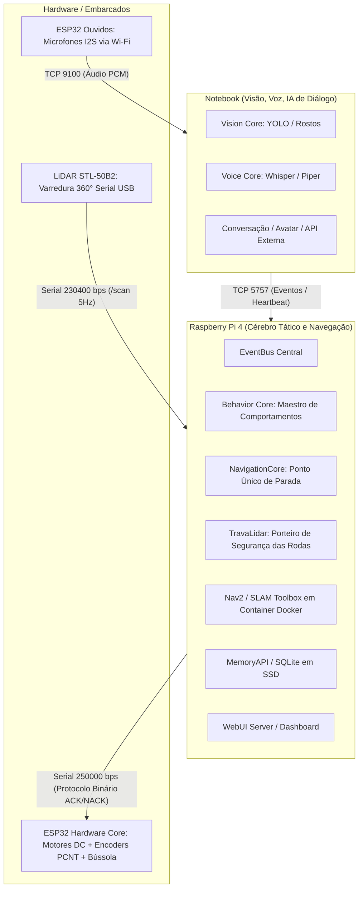
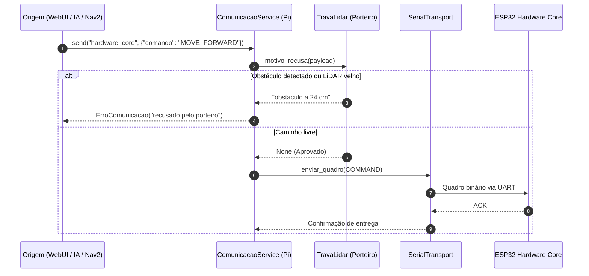
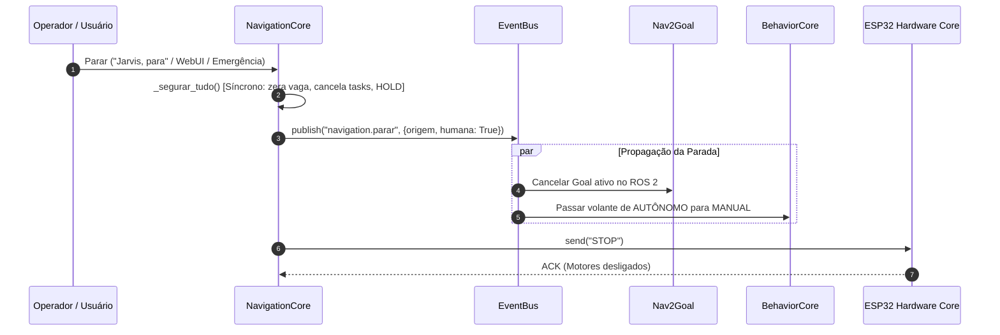

# Arquitetura e Relatório de Auditoria — Orion OS (10/11/2026)

Este documento consolida o estado real do sistema, o detalhamento técnico de todas as correções implementadas durante a auditoria multicamada (09 e 10/11/2026) e a especificação de como a arquitetura do **Orion OS** deve operar com segurança e previsibilidade.

---

## 1. Visão Geral da Arquitetura do Orion OS

O Orion OS é uma plataforma de robótica móvel modular baseada na filosofia **offline-first** e em **segurança em três camadas independentes**. A inteligência conversacional avançada roda no topo, enquanto a segurança mecânica e reflexa opera na base, imune a engasgos de rede ou processamento de modelos neurais.

---

## 2. A Hierarquia de Segurança em 3 Camadas

A regra fundamental da arquitetura é: **nenhum módulo de camada superior pode anular ou ignorar a segurança da camada inferior**.

1. **Camada 1: Reflexa e Homem-Morto (ESP32 `hardware_core`)**
   - Roda em tempo real direto nos microcontroladores.
   - **Watchdog de tração**: Se o Raspberry Pi parar de enviar comandos de tração ou heartbeats por mais de 500 ms (ou tempo limite configurado), os motores são desligados por hardware.
   - **Teto de PWM**: Proteção contra sobrecorrente e travamento de motor no driver L298N.
   - Não depende de software do Pi, Wi-Fi, IA ou sistema operacional.

2. **Camada 2: Tática e Espacial (Raspberry Pi `TravaLidar`)**
   - Age como **porteiro obrigatório** no enlace com o corpo (`ComunicacaoService.definir_porteiro("hardware_core")`).
   - Todo e qualquer comando que movimenta rodas (`MOVE_FORWARD`, `MOVE_DISTANCE`, `MOVE_CONTINUOUS`, `CMD_VEL`, `TURN_LEFT`, `TURN_RIGHT`) tem que ser aprovado pela trava antes de ir para a porta serial.
   - **Corredor de Avanço e Ré**: Garante que o robô não ande em direção a obstáculos a menos de 50 cm (autônomo) ou 25 cm (manual).
   - **Círculo de Giro do Eixo**: Garante que o giro no lugar seja recusado ou interrompido se houver obstáculos num raio de 37,5 cm ao redor do eixo dianteiro de tração.
   - **Watchdog de Varredura**: Se o robô estiver se movendo e o LiDAR silenciar por mais de 0,6 s, o movimento é abortado com `STOP`.

3. **Camada 3: Estratégica e Comportamental (`BehaviorCore` e `NavigationCore`)**
   - **Maestro**: Decide entre comportamentos autônomos (`Repouso`, `Ronda`, `AcompanharPessoa`, `IaEstrategica`) e controle manual.
   - **Arbitragem de Controle**: Quando uma ordem humana de parada chega, o controle é imediatamente retirado da IA e transferido para `MANUAL`.
   - **Nav2**: Responsável por planejar rotas e desvios globais, operando com footprint retangular real do robô.

---

## 3. O que foi feito na Auditoria Multicamada (09 e 10/11/2026)

Todas as falhas identificadas pelos auditores e verificadas com provas executáveis foram corrigidas no branch [`auditoria-2026-11-09`](file:///C:/Users/jproma/ORION_backup/auditoria).

### Bloco 1: Parar de Verdade (Cadeia de Parada Incondicional)
- **Ponto Único [`NavigationCore.parar_tudo`](file:///C:/Users/jproma/ORION_backup/auditoria/motion_core/navigation/navigation_core.py#L1085)**:
  - Elimina vagas de comando órfãs e cancela tarefas assíncronas ativas (`_tarefa_comando`, `_tarefa_follow`) sincronamente antes de qualquer `await`.
  - Coloca o robô em `HOLD`, trava novas velocidades do Nav2 (`_velocidade_travada = True`) e publica `navigation.parar`.
- **Gancho de Repasse (STOP falado C1-02 / C5-01)**:
  - Quando o comando falado "Jarvis, para" chega do Notebook ao Pi, o gancho em [`ComunicacaoService`](file:///C:/Users/jproma/ORION_backup/auditoria/src/orion/communication/service.py) intercepta o STOP repassado e aciona [`parar_ja("notebook")`](file:///C:/Users/jproma/ORION_backup/auditoria/motion_core/navigation/navigation_core.py#L1095), impedindo que modos como `FOLLOW` ou `EXPLORE` retomem a tração 200 ms depois.
- **Transição para MANUAL no STOP de Humano**:
  - Em [`BehaviorCore._ao_parar_navegacao`](file:///C:/Users/jproma/ORION_backup/auditoria/motion_core/behavior/behavior_core.py#L210), quando um humano envia um STOP com o robô em `AUTÔNOMO`, o volante é passado para `MANUAL`, impedindo que a IA re-decida andar logo em seguida.
- **Filtro Rápido de Fala (C5-02)**:
  - O reconhecimento de "para" e "pare" em [`mission_planner.py`](file:///C:/Users/jproma/ORION_backup/auditoria/src/orion/mission/mission_planner.py) foi antecipado para antes da consulta pesada de contexto e memória, reduzindo o tempo de resposta de 6 s para milissegundos.
- **Testes**: 24 testes unitários dedicados em [`tests/unit/test_parar_de_verdade.py`](file:///C:/Users/jproma/ORION_backup/auditoria/tests/unit/test_parar_de_verdade.py) passando.

---

### Bloco 2: Trava de Segurança, Raio Único, Ré Manual e Giro
- **Raio de Segurança Unificado no YAML ([`config/orion.yaml`](file:///C:/Users/jproma/ORION_backup/auditoria/config/orion.yaml))**:
  - `chassi.raio_seguranca_m: 0.25`: único número de segurança física configurado.
  - `chassi.lidar_ate_eixo_motriz_m: 0.10`: LiDAR posicionado 10 cm atrás do eixo das rodas dianteiras motrizes.
  - Teste [`test_medidas_corpo.py`](file:///C:/Users/jproma/ORION_backup/auditoria/tests/unit/test_medidas_corpo.py) amarra os 25 cm com `motion.min_front_distance_cm` e `motion.trava_lidar.piso_manual_cm`.
- **Correção da Ré no Manual (C1-04 / C2-10)**:
  - O piso anterior de 15 cm contados do LiDAR ficava dentro da carcaça traseira (que se estende até 22 cm atrás do LiDAR). Pelo filtro de carcaça, nenhum ponto $\le 22\text{ cm}$ passava, e como $22 > 15$, a ré manual nunca travava para obstáculo nenhum.
  - Com o piso elevado para 25 cm (`raio_seguranca_m`), obstáculos reais a 23–25 cm (1 a 3 cm da lataria traseira) voltam a travar a ré manual com segurança.
- **Proteção Ativa de Giro no Lugar ([`TravaLidar`](file:///C:/Users/jproma/ORION_backup/auditoria/motion_core/navigation/trava_lidar.py))**:
  - O robô possui rodas motrizes na frente e roda boba atrás. O centro de rotação no giro em torno do próprio eixo é o **ponto médio do eixo dianteiro**.
  - O canto traseiro do robô fica a $x = -32\text{ cm}$ e $y = \pm 19,5\text{ cm}$ do eixo dianteiro, varrendo um círculo de raio $\sqrt{32^2 + 19,5^2} \approx 37,5\text{ cm}$.
  - Comandos de giro (`TURN_LEFT`, `TURN_RIGHT`, e `CMD_VEL` com velocidade angular pura) agora acionam `_mais_perto_no_giro()`, que bloqueia o comando ou interrompe o giro se houver obstáculos num raio de 37,5 cm ao redor do eixo dianteiro.
  - Pontos que residem dentro da caixa física da carcaça do robô são descartados para não provocar falsas paradas por eco próprio.
- **Testes**: 34 testes unitários em [`tests/unit/test_trava_lidar.py`](file:///C:/Users/jproma/ORION_backup/auditoria/tests/unit/test_trava_lidar.py) passando.

---

### Bloco 3: Nav2 e LiDAR de 360 Raios (Commit `085e680`)
- **LiDAR Completo para o Nav2 ([`bridge_scan_odom.py`](file:///C:/Users/jproma/ORION_backup/auditoria/nav2/src/orion_nav2/orion_nav2/bridge_scan_odom.py))**:
  - Publicação de todos os 360 raios no ângulo correto para o tópico `/scan` (em vez de apenas 12 setores agrupados incorretamente).
  - Raios sem eco (`None`/`NaN`) convertidos para `inf` com `inf_is_valid: true`, limpando o costmap sem causar exceções de tipo (`TypeError`).
- **Ponte Resiliente e Desacoplada**:
  - Nós do ROS 2 configurados com `respawn: true` no arquivo de launch.
  - Carimbo temporal ajustado com desconto de idade da varredura real, evitando mundo congelado no costmap.
- **Footprint Retangular Real ([`nav2_params.yaml`](file:///C:/Users/jproma/ORION_backup/auditoria/nav2/src/orion_nav2/config/nav2_params.yaml))**:
  - Substituição de `robot_radius: 0.20` pelo polígono retangular exato do robô: `[[-0.32, -0.195], [-0.32, 0.195], [0.03, 0.195], [0.03, -0.195]]`.
  - TF estática `base_link -> laser` fixada em `(-0.10, 0, 0.45)` em [`nav.launch.py`](file:///C:/Users/jproma/ORION_backup/auditoria/nav2/src/orion_nav2/orion_nav2/nav.launch.py).
- **Controle da WebUI**:
  - Resposta `423 Locked` para `/velocidade` após recepção de `navigation.parar`, até a chegada de um novo goal.
  - Cancelamento formal de goal quando o botão `AUTÔNOMO` é desativado ou reacionado.

---

### Bloco 4: Firmware ESP32 (Hardware Core e Ouvidos)
- **Protocolo com Resposta NACK Obrigatória**:
  - Em [`command_executor.h`](file:///C:/Users/jproma/ORION_backup/auditoria/firmware/hardware_core/include/command_executor.h), comandos não reconhecidos ou com parâmetros inválidos recebem resposta de erro explícita (`NACK`), em vez de serem ignorados silenciosamente com falso ACK.
- **Homem-Morto Verdadeiro ([`safety_manager.h`](file:///C:/Users/jproma/ORION_backup/auditoria/firmware/hardware_core/include/safety_manager.h))**:
  - O watchdog de segurança física só é renovado por comandos legítimos de roda ou heartbeat comprovado do Pi. Comandos de servo (câmera) não renovam mais o tempo de vida de comandos de tração contínua.
- **Proteção de Bússola e Odometria ([`bussola_manager.h`](file:///C:/Users/jproma/ORION_backup/auditoria/firmware/hardware_core/include/bussola_manager.h))**:
  - Se a leitura I2C da bússola congelar ou falhar, o rumo é invalidado imediatamente para não anular os giros lidos pelo encoder de pulsos.
- **Correção Física do Relé da Lanterna ([`pins.h`](file:///C:/Users/jproma/ORION_backup/auditoria/firmware/hardware_core/include/pins.h))**:
  - O pino do relé foi transferido de `GPIO 2` para `GPIO 17`. O GPIO 2 é strapping pin do ESP32 e impedia a placa de ligar se estivesse em nível alto.
- **Compilação e Testes**: PlatformIO compilando 100% sem erros tanto para `hardware_core` quanto para `ouvidos_esp32`; 40 testes unitários em [`test_firmware_hardware_core.py`](file:///C:/Users/jproma/ORION_backup/auditoria/tests/unit/test_firmware_hardware_core.py) passando.

---

### Bloco 6: Voz, IA, Kernel e Dependências
- **Isolamento de Áudio e Voz ([`sintese.py`](file:///C:/Users/jproma/ORION_backup/auditoria/src/orion/voice/sintese.py))**:
  - Trava de exclusão mútua (`_trava_fala`) garantindo que duas reproduções de áudio nunca toquem ao mesmo tempo através do `sounddevice`, prevenindo segfaults e corrupção de buffer.
- **Proteção do EventBus ([`event_bus.py`](file:///C:/Users/jproma/ORION_backup/auditoria/src/orion/kernel/event_bus.py))**:
  - Handlers síncronos pesados não bloqueiam mais a fila de despacho principal de eventos.
- **Timeout em Chamadas de IA ([`ai_manager.py`](file:///C:/Users/jproma/ORION_backup/auditoria/src/orion/mission/ai_manager.py))**:
  - Timeout explícito configurado nas chamadas externas de LLM para impedir congelamento de minutos na thread do maestro.
- **Dependências e Empacotamento ([`pyproject.toml`](file:///C:/Users/jproma/ORION_backup/auditoria/pyproject.toml))**:
  - Dependências declaradas e alinhadas (FastAPI, Uvicorn, Pydantic, etc.).
- **Plugins Jarvis Desligados**:
  - Mantidos desativados por padrão para segurança de execução local.

---

## 4. Como a Arquitetura Deve Funcionar no Dia a Dia

### Fluxo de Comando de Tração

### Fluxo de Parada Incondicional (STOP)

---

## 5. Próximos Passos Recomendados

1. **Procedimento Físico de Hardware**:
   - Antes de conectar e gravar o binário atualizado no ESP32 do corpo, certificar-se de mudar a ligação do relé da lanterna do **GPIO 2** para o **GPIO 17**.
2. **Consolidação do Repositório**:
   - Manter os commits atômicos por bloco no branch `auditoria-2026-11-09`.
   - Manter os plugins do Jarvis desligados até a implementação de um sandbox restrito.
3. **Validação em Bancada**:
   - Testar o robô suspenso (rodas livres) verificando a resposta imediata aos comandos manuais, travamento de giro ao aproximar anteparo lateral a menos de 37,5 cm do eixo dianteiro, e corte imediato da ré a 25 cm de obstáculo traseiro.
