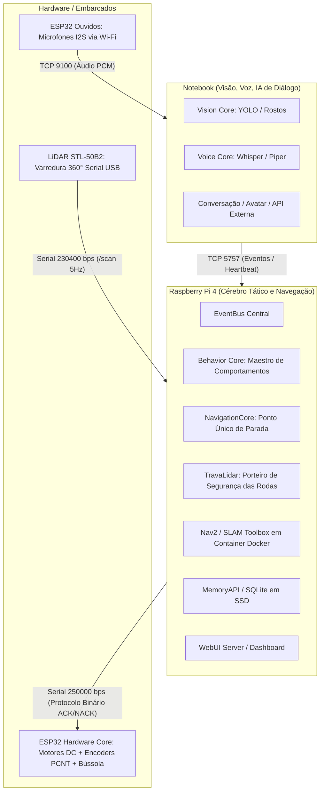
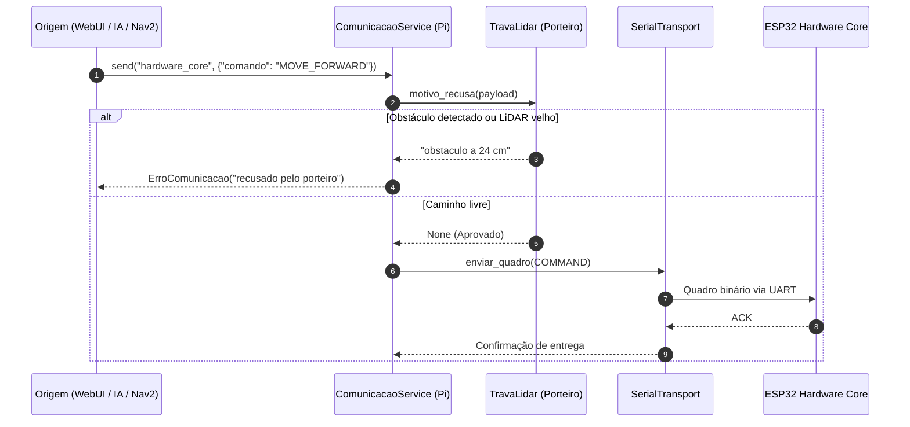
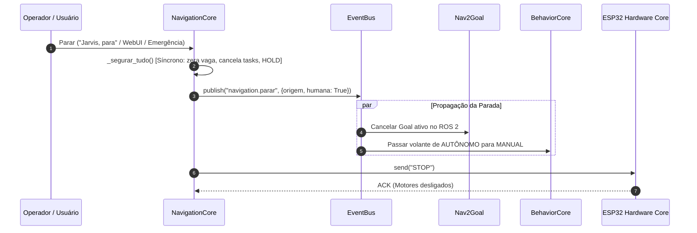

# Arquitetura e Relatório de Auditoria — Orion OS (10/11/2026)

Este documento consolida o estado real do sistema, o detalhamento técnico de todas as correções implementadas durante a auditoria multicamada (09 e 10/11/2026) e a especificação de como a arquitetura do **Orion OS** deve operar com segurança e previsibilidade.

---

## 1. Visão Geral da Arquitetura do Orion OS

O Orion OS é uma plataforma de robótica móvel modular baseada na filosofia **offline-first** e em **segurança em três camadas independentes**. A inteligência conversacional avançada roda no topo, enquanto a segurança mecânica e reflexa opera na base, imune a engasgos de rede ou processamento de modelos neurais.

---

## 2. A Hierarquia de Segurança em 3 Camadas

A regra fundamental da arquitetura é: **nenhum módulo de camada superior pode anular ou ignorar a segurança da camada inferior**.

1. **Camada 1: Reflexa e Homem-Morto (ESP32 `hardware_core`)**
   - Roda em tempo real direto nos microcontroladores.
   - **Watchdog de tração**: Se o Raspberry Pi parar de enviar comandos de tração ou heartbeats por mais de 500 ms (ou tempo limite configurado), os motores são desligados por hardware.
   - **Teto de PWM**: Proteção contra sobrecorrente e travamento de motor no driver L298N.
   - Não depende de software do Pi, Wi-Fi, IA ou sistema operacional.

2. **Camada 2: Tática e Espacial (Raspberry Pi `TravaLidar`)**
   - Age como **porteiro obrigatório** no enlace com o corpo (`ComunicacaoService.definir_porteiro("hardware_core")`).
   - Todo e qualquer comando que movimenta rodas (`MOVE_FORWARD`, `MOVE_DISTANCE`, `MOVE_CONTINUOUS`, `CMD_VEL`, `TURN_LEFT`, `TURN_RIGHT`) tem que ser aprovado pela trava antes de ir para a porta serial.
   - **Corredor de Avanço e Ré**: Garante que o robô não ande em direção a obstáculos a menos de 50 cm (autônomo) ou 25 cm (manual).
   - **Círculo de Giro do Eixo**: Garante que o giro no lugar seja recusado ou interrompido se houver obstáculos num raio de 37,5 cm ao redor do eixo dianteiro de tração.
   - **Watchdog de Varredura**: Se o robô estiver se movendo e o LiDAR silenciar por mais de 0,6 s, o movimento é abortado com `STOP`.

3. **Camada 3: Estratégica e Comportamental (`BehaviorCore` e `NavigationCore`)**
   - **Maestro**: Decide entre comportamentos autônomos (`Repouso`, `Ronda`, `AcompanharPessoa`, `IaEstrategica`) e controle manual.
   - **Arbitragem de Controle**: Quando uma ordem humana de parada chega, o controle é imediatamente retirado da IA e transferido para `MANUAL`.
   - **Nav2**: Responsável por planejar rotas e desvios globais, operando com footprint retangular real do robô.

---

## 3. O que foi feito na Auditoria Multicamada (09 e 10/11/2026)

Todas as falhas identificadas pelos auditores e verificadas com provas executáveis foram corrigidas no branch [`auditoria-2026-11-09`](file:///C:/Users/jproma/ORION_backup/auditoria).

### Bloco 1: Parar de Verdade (Cadeia de Parada Incondicional)
- **Ponto Único [`NavigationCore.parar_tudo`](file:///C:/Users/jproma/ORION_backup/auditoria/motion_core/navigation/navigation_core.py#L1085)**:
  - Elimina vagas de comando órfãs e cancela tarefas assíncronas ativas (`_tarefa_comando`, `_tarefa_follow`) sincronamente antes de qualquer `await`.
  - Coloca o robô em `HOLD`, trava novas velocidades do Nav2 (`_velocidade_travada = True`) e publica `navigation.parar`.
- **Gancho de Repasse (STOP falado C1-02 / C5-01)**:
  - Quando o comando falado "Jarvis, para" chega do Notebook ao Pi, o gancho em [`ComunicacaoService`](file:///C:/Users/jproma/ORION_backup/auditoria/src/orion/communication/service.py) intercepta o STOP repassado e aciona [`parar_ja("notebook")`](file:///C:/Users/jproma/ORION_backup/auditoria/motion_core/navigation/navigation_core.py#L1095), impedindo que modos como `FOLLOW` ou `EXPLORE` retomem a tração 200 ms depois.
- **Transição para MANUAL no STOP de Humano**:
  - Em [`BehaviorCore._ao_parar_navegacao`](file:///C:/Users/jproma/ORION_backup/auditoria/motion_core/behavior/behavior_core.py#L210), quando um humano envia um STOP com o robô em `AUTÔNOMO`, o volante é passado para `MANUAL`, impedindo que a IA re-decida andar logo em seguida.
- **Filtro Rápido de Fala (C5-02)**:
  - O reconhecimento de "para" e "pare" em [`mission_planner.py`](file:///C:/Users/jproma/ORION_backup/auditoria/src/orion/mission/mission_planner.py) foi antecipado para antes da consulta pesada de contexto e memória, reduzindo o tempo de resposta de 6 s para milissegundos.
- **Testes**: 24 testes unitários dedicados em [`tests/unit/test_parar_de_verdade.py`](file:///C:/Users/jproma/ORION_backup/auditoria/tests/unit/test_parar_de_verdade.py) passando.

---

### Bloco 2: Trava de Segurança, Raio Único, Ré Manual e Giro
- **Raio de Segurança Unificado no YAML ([`config/orion.yaml`](file:///C:/Users/jproma/ORION_backup/auditoria/config/orion.yaml))**:
  - `chassi.raio_seguranca_m: 0.25`: único número de segurança física configurado.
  - `chassi.lidar_ate_eixo_motriz_m: 0.10`: LiDAR posicionado 10 cm atrás do eixo das rodas dianteiras motrizes.
  - Teste [`test_medidas_corpo.py`](file:///C:/Users/jproma/ORION_backup/auditoria/tests/unit/test_medidas_corpo.py) amarra os 25 cm com `motion.min_front_distance_cm` e `motion.trava_lidar.piso_manual_cm`.
- **Correção da Ré no Manual (C1-04 / C2-10)**:
  - O piso anterior de 15 cm contados do LiDAR ficava dentro da carcaça traseira (que se estende até 22 cm atrás do LiDAR). Pelo filtro de carcaça, nenhum ponto $\le 22\text{ cm}$ passava, e como $22 > 15$, a ré manual nunca travava para obstáculo nenhum.
  - Com o piso elevado para 25 cm (`raio_seguranca_m`), obstáculos reais a 23–25 cm (1 a 3 cm da lataria traseira) voltam a travar a ré manual com segurança.
- **Proteção Ativa de Giro no Lugar ([`TravaLidar`](file:///C:/Users/jproma/ORION_backup/auditoria/motion_core/navigation/trava_lidar.py))**:
  - O robô possui rodas motrizes na frente e roda boba atrás. O centro de rotação no giro em torno do próprio eixo é o **ponto médio do eixo dianteiro**.
  - O canto traseiro do robô fica a $x = -32\text{ cm}$ e $y = \pm 19,5\text{ cm}$ do eixo dianteiro, varrendo um círculo de raio $\sqrt{32^2 + 19,5^2} \approx 37,5\text{ cm}$.
  - Comandos de giro (`TURN_LEFT`, `TURN_RIGHT`, e `CMD_VEL` com velocidade angular pura) agora acionam `_mais_perto_no_giro()`, que bloqueia o comando ou interrompe o giro se houver obstáculos num raio de 37,5 cm ao redor do eixo dianteiro.
  - Pontos que residem dentro da caixa física da carcaça do robô são descartados para não provocar falsas paradas por eco próprio.
- **Testes**: 34 testes unitários em [`tests/unit/test_trava_lidar.py`](file:///C:/Users/jproma/ORION_backup/auditoria/tests/unit/test_trava_lidar.py) passando.

---

### Bloco 3: Nav2 e LiDAR de 360 Raios (Commit `085e680`)
- **LiDAR Completo para o Nav2 ([`bridge_scan_odom.py`](file:///C:/Users/jproma/ORION_backup/auditoria/nav2/src/orion_nav2/orion_nav2/bridge_scan_odom.py))**:
  - Publicação de todos os 360 raios no ângulo correto para o tópico `/scan` (em vez de apenas 12 setores agrupados incorretamente).
  - Raios sem eco (`None`/`NaN`) convertidos para `inf` com `inf_is_valid: true`, limpando o costmap sem causar exceções de tipo (`TypeError`).
- **Ponte Resiliente e Desacoplada**:
  - Nós do ROS 2 configurados com `respawn: true` no arquivo de launch.
  - Carimbo temporal ajustado com desconto de idade da varredura real, evitando mundo congelado no costmap.
- **Footprint Retangular Real ([`nav2_params.yaml`](file:///C:/Users/jproma/ORION_backup/auditoria/nav2/src/orion_nav2/config/nav2_params.yaml))**:
  - Substituição de `robot_radius: 0.20` pelo polígono retangular exato do robô: `[[-0.32, -0.195], [-0.32, 0.195], [0.03, 0.195], [0.03, -0.195]]`.
  - TF estática `base_link -> laser` fixada em `(-0.10, 0, 0.45)` em [`nav.launch.py`](file:///C:/Users/jproma/ORION_backup/auditoria/nav2/src/orion_nav2/orion_nav2/nav.launch.py).
- **Controle da WebUI**:
  - Resposta `423 Locked` para `/velocidade` após recepção de `navigation.parar`, até a chegada de um novo goal.
  - Cancelamento formal de goal quando o botão `AUTÔNOMO` é desativado ou reacionado.

---

### Bloco 4: Firmware ESP32 (Hardware Core e Ouvidos)
- **Protocolo com Resposta NACK Obrigatória**:
  - Em [`command_executor.h`](file:///C:/Users/jproma/ORION_backup/auditoria/firmware/hardware_core/include/command_executor.h), comandos não reconhecidos ou com parâmetros inválidos recebem resposta de erro explícita (`NACK`), em vez de serem ignorados silenciosamente com falso ACK.
- **Homem-Morto Verdadeiro ([`safety_manager.h`](file:///C:/Users/jproma/ORION_backup/auditoria/firmware/hardware_core/include/safety_manager.h))**:
  - O watchdog de segurança física só é renovado por comandos legítimos de roda ou heartbeat comprovado do Pi. Comandos de servo (câmera) não renovam mais o tempo de vida de comandos de tração contínua.
- **Proteção de Bússola e Odometria ([`bussola_manager.h`](file:///C:/Users/jproma/ORION_backup/auditoria/firmware/hardware_core/include/bussola_manager.h))**:
  - Se a leitura I2C da bússola congelar ou falhar, o rumo é invalidado imediatamente para não anular os giros lidos pelo encoder de pulsos.
- **Correção Física do Relé da Lanterna ([`pins.h`](file:///C:/Users/jproma/ORION_backup/auditoria/firmware/hardware_core/include/pins.h))**:
  - O pino do relé foi transferido de `GPIO 2` para `GPIO 17`. O GPIO 2 é strapping pin do ESP32 e impedia a placa de ligar se estivesse em nível alto.
  - Hoje não há nada ligado nesse pino (a lanterna não está montada, dono 11/11): é só reserva, nenhum fio precisa mudar.
- **Compilação e Testes**: PlatformIO compilando 100% sem erros tanto para `hardware_core` quanto para `ouvidos_esp32`; 40 testes unitários em [`test_firmware_hardware_core.py`](file:///C:/Users/jproma/ORION_backup/auditoria/tests/unit/test_firmware_hardware_core.py) passando.

---

### Bloco 6: Voz, IA, Kernel e Dependências
- **Isolamento de Áudio e Voz ([`sintese.py`](file:///C:/Users/jproma/ORION_backup/auditoria/src/orion/voice/sintese.py))**:
  - Trava de exclusão mútua (`_trava_fala`) garantindo que duas reproduções de áudio nunca toquem ao mesmo tempo através do `sounddevice`, prevenindo segfaults e corrupção de buffer.
- **Proteção do EventBus ([`event_bus.py`](file:///C:/Users/jproma/ORION_backup/auditoria/src/orion/kernel/event_bus.py))**:
  - Handlers síncronos pesados não bloqueiam mais a fila de despacho principal de eventos.
- **Timeout em Chamadas de IA ([`ai_manager.py`](file:///C:/Users/jproma/ORION_backup/auditoria/src/orion/mission/ai_manager.py))**:
  - Timeout explícito configurado nas chamadas externas de LLM para impedir congelamento de minutos na thread do maestro.
- **Dependências e Empacotamento ([`pyproject.toml`](file:///C:/Users/jproma/ORION_backup/auditoria/pyproject.toml))**:
  - Dependências declaradas e alinhadas (FastAPI, Uvicorn, Pydantic, etc.).
- **Plugins Jarvis Desligados**:
  - Mantidos desativados por padrão para segurança de execução local.

---

## 4. Como a Arquitetura Deve Funcionar no Dia a Dia

### Fluxo de Comando de Tração

### Fluxo de Parada Incondicional (STOP)

---

## 5. Próximos Passos Recomendados

1. **Consolidação do Repositório**:
   - Manter os commits atômicos por bloco no branch `auditoria-2026-11-09`.
   - Manter os plugins do Jarvis desligados até a implementação de um sandbox restrito.
2. **Validação em Bancada**:
   - Testar o robô suspenso (rodas livres) verificando a resposta imediata aos comandos manuais, travamento de giro ao aproximar anteparo lateral a menos de 37,5 cm do eixo dianteiro, e corte imediato da ré a 25 cm de obstáculo traseiro.

---

## 6. Camada Visão / YOLO (12/11/2026)

Queixa do dono: *"o YOLO, a visão não tá funcionando, não reconhece nada"*. O robô estava
desligado (Pi sem resposta pelo Tailscale), então a auditoria foi no código do backup, com
cada achado provado por teste que falhava antes do conserto
(`tests/unit/test_visao_auditoria_12_11.py`).

Ponto de partida: a visão que roda é a do **Notebook** (`src/orion/vision/`, câmera DV20 na
USB dele). O Vision Engine do Pi (`motion_core/vision/`) está desligado de propósito desde
01/11 (`vision.pi_engine_ativo: false`) e não é a causa.

| # | Achado | Prova | Conserto |
|---|--------|-------|----------|
| V1 | **Câmera boa vira "sem sinal"**: cena parada + pouco ruído + MJPEG q80 dá diferença 0,13 entre quadros, abaixo do limiar 0,20 de "imagem congelada". O YOLO para de rodar e a resposta é "não estou vendo nada". | simulação: ruído 0,5 → 0,13 (falso SEM SINAL); ruído 1,0 → 0,26 (margem de nada) | limiar 0,02 — o congelado de verdade (mesmo JPEG reenviado) dá exatamente 0 |
| V2 | **Rosto de perto não tem nome**: só rosto dentro de caixa `person` do YOLO virava identidade. De perto o YOLO não acha corpo (15 de 34 fotos reais, medido em 07/2026). Sem nome na cena, sem `vision.person_recognized` → sem saudação, recado, diário. | teste: rosto do João sem corpo → `reconhecidos == []` | rosto conhecido sem corpo entra na cena; sem alvo rastreado, publica `person_recognized` (`so_rosto: true`) |
| V3 | **Um rosto dava nome a duas pessoas**: qualquer sobreposição > 0, sem exclusividade. Lado a lado, as duas viravam "João" — o FOLLOW podia seguir a errada. | teste: Ana recebia o nome do João | centro do rosto dentro da caixa + um rosto por pessoa |
| V4 | **Cego e sala vazia davam a mesma frase**: pausada, câmera fechada, escuro, sem sinal ou visão que nem iniciou → "não estou vendo nada". A IA também não sabia que estava cega. | teste do planner | `motivo_cego()` no VisionCore/ModuloVisao; o planner diz "Não consigo enxergar agora: …" e põe isso no contexto da IA |
| V5 | **Modelo relativo à pasta do processo**: `"yolov8n.pt"` solto; o serviço roda de `~/orion-os` ou `~/orion-jarvis`. Na pasta sem o arquivo o Ultralytics baixa; sem internet `YOLO()` levanta, o boot engole ("Visão indisponível") e a visão inteira some, rostos inclusive. | leitura: `modulo.py` + `orion-avatar.service` | procura primeiro em `data/modelos/` do projeto (como o Pi) e avisa alto no log quando não acha |

| V6 | **O alvo trocava de pessoa**: com alvo, o rastreador pegava a caixa mais próxima; se o João saía e a Ana estava perto, o alvo virava a Ana sem `person_lost`. E o nome se perdia no quadro em que o rosto sumia (de costas) → o FOLLOW largava a pessoa. | 4 testes em `test_vision_rastreamento.py` | dono: *"podemos usar o reconhecimento"* — alvo com nome segue o ROSTO: mesma pessoa_id ganha onde estiver; outra pessoa conhecida nunca vira alvo; caixa sem rosto só se colada à anterior, e o alvo guarda o nome |

Observações sem conserto (anotadas):
- `descartar_atrasados` liga para a DV20 local porque o `by-id` é string; inofensivo
  (o `grab()` local espera o quadro novo e sai no 1º laço).

**Ao aplicar, conferir no Notebook** (ordem): `ls ~/orion-*/data/modelos/yolov8n.pt` (V5) →
`grep -E "SEM SINAL|Visao indisponivel|nao esta em" ~/orion-jarvis/data/logs/*.log | tail` (V1/V5)
→ perguntar "o que você está vendo?" de perto, de longe e com a lente tampada (V2/V4).

Também em 12/11 (commit 86d2ff7): a câmera entra na odometria — giro medido pela imagem,
com as caixas do YOLO apagando pessoas e animais; testemunha do encoder no Pi; correção da
pose desligada (`peso_camera: 0`) até medir o FOV da DV20.

---

## 7. Achados antigos que ainda estavam abertos (12/11/2026)

Conferido no branch o que dos relatórios de 09-10/11 não tinha entrado em nenhum bloco.
**Já estavam consertados:** A2 (prazo no `drain`), A3 (exceção qualquer na recepção do
link), A5 (`goal_resultado` tem assinante), C4-02 (teto de duty no firmware). O FOLLOW para
sozinho quando a visão some (timeout de perda): a queda do Notebook não deixa o robô andando.

| Achado | O que era | Conserto | Commit |
|---|---|---|---|
| C2-04 | Bússola que só fica válida com o robô já andando alinhava de uma vez: a orientação saltava até 180° e o mapa do Nav2 girava junto (teste: 180,0 contra 0). | Entra relativa (guarda a diferença daquele instante) e só corrige a deriva dali em diante. | `fusao` |
| C5-04 | "Quero parar de fumar" parava o robô e a frase morria em "Parado.". | AGIR x FALAR: o STOP sai sempre; se sobra conteúdo além da ordem, a frase segue para a conversa. | `planner` |
| C6-07 | `follow_distance_m: 1.2` no yaml, ninguém lia; o código usava 80 cm fixos. | Ligado ao yaml com 0,8 (o que rodou no teste de 08/11). | `navegacao` |
| C5-09 | Com `goap: true` o planejador ignorava `acoes_permitidas` e as manobras finas voltavam. | Filtra pelas permitidas (sobram 9). GOAP hoje desligado. | `goap` |

**Segunda rodada (12/11, dono: "faz tudo isso, web ui sem senha"):**

| Achado | O que era | Conserto |
|---|---|---|
| C2-07 | Distâncias do retrato da IA contadas do centro do LiDAR: "frente 33" eram 25 cm da ponta; "trás 30" eram 8 cm da lataria. | Frente/trás/lados, corredor das 8 direções e desvio frontal contados da LATARIA (8/22/19,5 cm, as medidas da trava); eco de dentro da carcaça ignorado. Padrão do construtor = corpo real. |
| C1-07 | Ponte `/cmd_vel` pegava o volante uma vez na vida. | Já consertado em 10/11 (por episódio); faltava teste — 3 testes com ROS falso. |
| C6-01 | A visão do Notebook move a cabeça direto ao corpo; o Pi só repassava e o FOLLOW calculava a pessoa com a cabeça "no centro". | Gancho de repasse no `ComunicacaoService` (só depois do envio) publica `motion.cabeca_posicao`. |
| C6-02 | `motion.pan_tilt` é PEDIDO e o Pi descarta parte (MANUAL, operador, taxa) — mas todos atualizavam a posição mesmo assim. | Só o que saiu ao ESP32 vira `motion.cabeca_posicao` (o FATO), e só isso vai ao Notebook. FOLLOW e retrato ouvem o fato. |
| C5-05 | Contexto (até 4 idas à memória do Pi) montado antes de hora/aula responderem; todo turno ia ao extrator, que gasta cota com "Parado.". | Contexto só quando usado (diário e IA); extrator só recebe turnos que passaram pela IA. |
| C5-08 | Vault síncrono no laço do Pi. | Já consertado (`asyncio.to_thread` na ponte de memória). |
| A4 | Prova de vida passava pela fila do bus: handler lento = "perdi o corpo" + reconexão que reseta o ESP32. | Qualquer mensagem válida conta como vida na recepção, antes do bus; laço atrasado não julga perda. Teste falhava sem o conserto. |

**Decisão do dono (12/11): a webui fica SEM SENHA.** Registrado como escolha, não como
pendência. A API 8081 e o TCP 5757 continuam abertos na rede local, do jeito que estão.

---

## 8. Médios e baixos (12/11/2026, terceira rodada)

| Achado | O que era | Conserto |
|---|---|---|
| **novo** | `CALIBRATE_COMPASS` com `girar` (gira no lugar; pedido pela IA, instinto e voz) e `TEST_WHEEL` (anda até 1,2 s) passavam pela trava sem checagem. | Calibrar girando = GIRO; teste de roda = frente/ré/GIRO. A bancada (`tools/testar_roda.py`) fala direto com a serial e não muda. |
| C1-08 | Traseira cega liberava a ré (frente cega já travava desde 01/11). | Mesma regra atrás: 60% sem eco em ±20° = obstáculo; uma varredura solta não para, duas param. |
| C2-06 | Janela de ~3,4 voltas + "menor distância vence" = obstáculo fantasma ~350 ms depois de girar. | STL-50B2: dentro do quadro vale o menor; entre quadros, o mais novo. Cobertura igual. |
| A6 | Firmware com protocolo de outra versão = "Hardware Core não encontrado" (parecia cabo solto). | Vai para os erros da webui e o Pi loga "REGRAVAR o firmware". |
| C5-10 | `ia_estrategica.intervalo_s` duas vezes (300 e 600); rodava 600. | Ficou só o 600; teste proíbe chave repetida em qualquer YAML. |
| C5-11 | Tarefa do contador de IA sem referência. | `disparar()`. |
| config | 25 chaves sem leitor; `security` parecia proteger e não protegia nada. | `security` marcada como NÃO IMPLEMENTADA; teste vigia a lista (falha com chave nova sem leitor ou se a lista mentir). Nada apagado: é decisão do dono. |
| C6-08/09 | README dizia "python -m orion = boot real"; ARQUITETURA com tela ESP32-S3 e TB6600 sem encoder. | README com o serviço de cada máquina; ARQUITETURA com as mudanças datadas. |

**Conferidos e já consertados antes:** A7 (CancelledError no bus), C4-05 (motores no 1º passo do
boot; o resto da janela é pull-down de 10k, HARDWARE), C4-08 (ouvidos reiniciam sem Wi-Fi; OTA com
senha), C6-03 (fala cancelada espera o áudio acabar).

**Pendências de hardware (não são código):** pull-down de 10k nos IN1..IN4 do L298N (tranco no
reset); medir o FOV da DV20 para ligar `peso_camera`.

---

## 9. Passada nova (12/11/2026, quarta rodada)

Sem lista antiga para seguir: varreduras por classe de defeito.

| Achado | O que era | Conserto |
|---|---|---|
| Recado para nome inexistente (aberto desde 06/08) | "Marisani" (Whisper) x "Marisane" (apelido): "combinado, eu aviso" e o recado preso para sempre. | Na criação: guarda (nunca se perde) e, se o nome não casa com a família, diz a verdade e sugere o parecido ("Você quis dizer Marisane?"). |
| Rostos da família desistiam | 30 tentativas (5 min) e desistia até o reinício: SSD que voltasse depois = família inteira como estranha o dia todo. | Grita uma vez e segue tentando a cada 60 s (falhas em DEBUG na fase lenta, sem afogar o log). |
| **Publicar no vazio** (varredura de todos os tópicos) | `database.rebuilt` (memória perdida), `database.backup_failed`, `navigation.nav2_subindo/pronto/desligado`, `navigation.desvio` sem assinante. E `database.rebuilt` nem era publicado: `iniciar_banco()` só rodava nos testes. | Todos chegam à webui; os do banco nos erros recentes; o Pi publica o `rebuilt` depois de a webui subir. |
| Comando que mexe as rodas fora da trava (varredura) | `DOCK` conferido: só para o robô, e é proibido para a IA. | Nada a fazer; comentários falsos do `navigation_core` corrigidos. |

Restam sem assinante, só informativos: `database.ready`, `voice.transcription_ready`.

---

## 10. Varreduras por classe de defeito (12/11/2026, quinta rodada)

| Varredura | Resultado |
|---|---|
| Tarefa sem referência (`create_task` solto) | 2 no Notebook: fala da resposta do chat → `disparar()`. |
| Retentativa que desiste | Vozes da família desistiam em 5 min (como os rostos) → seguem a cada 60 s. |
| Rede sem prazo | Limpo (httpx, aiohttp e urllib têm timeout). |
| `except: pass` | Só em fechamento de socket/porta já caída — legítimo. |
| Código órfão | Só `LocalizadorDirecao` (direção da voz) — já conhecido, voz não é prioridade do dono. |
| Assinar o silêncio (tópico sem publicador) | Limpo (`motion.status` vem do firmware). |
| Relógio de parede em prazo (Pi sem RTC) | Limpo: `time.time()` só em datas gravadas e carimbos de tela. |
| C4-06 quadro serial | Já resolvido (768 B). |
| **C6-04 CSRF** | Sem senha continua (decisão do dono). Mas POST vindo de OUTRO SITE pelo navegador (Origin diferente ou `null`) agora é 403; painel, ponte do Nav2 e ferramentas seguem iguais. |

Scripts das varreduras (para refazer depois de mudanças grandes): `vazio.py`, `surdo.py`,
`orfaos.py`, `config_morta.py` no scratchpad da sessão de 12/11 — a de config virou teste
(`test_config_sem_leitor.py`).
